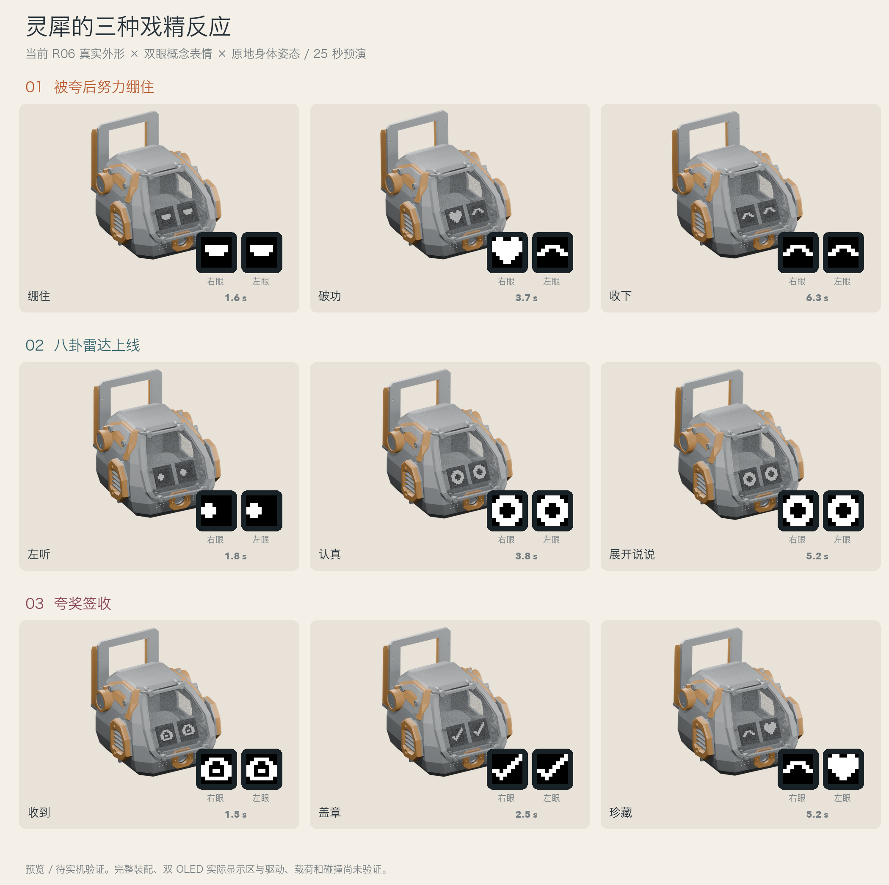

# R03 · 三种独特的戏精反应

2026-10-31。钟笑咪已确认 R02 对应图正确，本轮继续开发动作。沿用同一套 **红黑 EDGE50 几何配置＋R06 简化驾驶舱**，不更新外形设计或个人偏好。

状态：**动作概念预演 / 待实机验证**。展示后暂停后续实现和测试修复，等待钟笑咪反馈。

- [25 秒配音串场](unique_actions_reel.mp4)
- [静音循环预览](unique_actions_reel.gif)
- [九格动作图](three_actions_storyboard.png)
- 单独看：[被夸后努力绷住](hold_that_compliment/preview.mp4)、[八卦雷达上线](gossip_radar/preview.mp4)、[夸奖签收](compliment_receipt/preview.mp4)。



## 01 被夸后努力绷住 / 9 秒

最推荐作为本组招牌动作。笑点来自表情先暴露心情，再用台词装淡定。

| 时间 | 身体姿态目标 | 双眼 | 台词 |
| --- | --- | --- | --- |
| 0–1.3 s | 站稳，先不动 | 半眯淡定眼 | “嗯。” |
| 1.3–2.2 s | 继续定住，让观众等一拍 | 努力维持淡定 | 留白 |
| 2.2–3.3 s | 一下很小的原地侧摆 | `>_<`，像在忍笑 | 留白 |
| 3.3–5 s | 轻摆一次，短暂上提约 1 mm | 笑眼破功；右眼短暂冒出爱心 | 让眼睛先接梗 |
| 5.1–7.8 s | 轻微抬起姿态 | 满足笑眼 | “客观评价，我收下了。” |
| 7.8–9 s | 回中立姿态 | 右眼轻眨，恢复普通眼睛 | 收尾 |

这段没有突然爆发的大动作，方便之后作为“收到夸奖”的短反应；本轮仍为固定、离线编排，没有接入实时对话触发。

## 02 八卦雷达上线 / 8 秒

一句“不爱听”之后，动作逐渐暴露它其实很认真。

先用半眯眼保持镇定，说“我本来不爱听八卦。”；随后瞳孔向一边、另一边各瞄一次，机身朝向随之小幅变化。到约 3.6 秒时突然睁大眼睛、微微前倾并定住，再接“但你可以展开说说。”最后礼貌回正并眨眼。

没有新增耳朵或可转动的头部。“雷达”是表情与节奏的比喻，不涉及主动监听、采集聊天内容或新的麦克风行为。

## 03 夸奖签收 / 8 秒

把夸奖当作收到的一封小邮件，认真签收，再偷偷开心。

普通眼睛 → 收件箱图案 → 两眼对勾；机身做一次轻点头，再小点一次作为确认。台词是“夸奖已签收。”和“本人将循环回味。”随后一只眼睛变成爱心、另一只保持笑眼，配一次小侧摆；最后轻眨回正。

“循环回味”只是一句角色台词。动作本身只有有限时长，不会无限循环，也没有写入长期记忆。

## 构建和外形对应

本轮读取 R02 已确认场景 `aligned_r02/current_sources_preview.blend`，保留当前 R06 的 20 个实际 CAD 打印件，移除仅用于静态零件图的底盘孤立 STL。模型几何没有重新雕刻、缩放或变更；每段只给整个头部装配施加和身体目标一致的朝向示意。

**没有给驾驶舱增加独立颈部。** 实际动画中的倾斜、俯仰和偏航，都表示“整机应当达到的朝向”。当前尚缺经过验证的头部到六足总装变换，因此头部在图中使用其自身接口原点演示朝向，不能据此读取实际头部相对脚尖的运动轨迹。

腿部展示已撤掉不属于本机的通用杆件骨架，改为已确认的红黑机甲实物参照 `red_black_print_release_20261031/approved_color_reference.png`。该参照只用于确认腿件外观，**不参与动作，也不表示腿部动态装配已经校准**；在真实装配变换确认前，不再展示虚构的腿部运动。

眼睛使用两个独立的 **8×8 单色逻辑图案**。三维头部上是位于现有 OLED 参照内的概念覆盖，每个覆盖暂取 18×18 mm，便于审阅角色表演；这个尺寸不是实测有效显示区，也不代表屏幕像素分辨率。没有修改实体屏幕开孔、驱动或安装几何。原生 CAD 坐标为 +X 机器人右、+Y 前、+Z 上；放大图中的左右眼按正面观看顺序排列，并标注机器人自身的左右。

几何参数仍读取 R02 已用 C++ 编译核对的 EDGE50 配置：中腿 |X|=59.7 mm、角腿 |X|=50 mm、角腿 |Y|=58 mm；四段腿长为 19.4 / 32 / 43.8 / 90.05 mm。读取前验证 R02 记录中的源文件哈希，避免动作另起一套过期外形参数。

动作源码是 [actions.py](source/actions.py)，它同时生成每帧姿态和双眼逻辑图案。每个动作目录的 `timeline.json` 保存独立时间轴，头部渲染、放大眼睛及字幕均读取同一套函数；右下角腿件参照是静态实物图，不读取动作轨道。配音是本机 Tingting 临时样本，启动时间和实际音频时长见 [voice_manifest.json](voice_manifest.json)，不代表最终角色音色。

## 已核对与尚未验证

- 三段均以 20 ms 间隔检查理想运动学，共 1253 个机身姿态、7518 次腿部求解；所有目标可达，关节角度未超当前软件范围，六个脚尖目标保持固定，各段结尾回中立姿态。具体范围和数值误差见 [motion_checks.json](motion_checks.json)。
- 源模型、源几何记录及动作源码哈希见 [manifest.json](manifest.json)；渲染与合成记录分别为 [render_checks.json](render_checks.json)、[composition_manifest.json](composition_manifest.json)。
- 媒体解码、时长和来源一致性核对见 [delivery_checks.json](delivery_checks.json)。

本轮离线交付检查已通过：三段分别为 9 / 8 / 8 秒，串场 MP4 为 1600×1000、H.264 + AAC、24 fps，封装总长约 25.046 秒；完整串场解码无报错。双眼逻辑图案均为有效的 8×8 单色矩阵，源码和已确认模型的哈希一致。九格图已进行版式和关键表情核对。

仍未验证：完整实物装配、实际重心和动态稳定性、外壳及腿部碰撞、舵机载荷/速度/供电、双 OLED 的实际参数与驱动、实体语音与运动同步。固定六个脚尖不是稳定性验收。

## 软件部署入口

部署代码现已补齐：`source/generate_firmware_motion.py` 生成 `firmware/src/generated/movement_table_theater.h`；NodeHexa 表演控制器注册三个不循环预设；`firmware/lingji-xjwb03/theater_deploy.py` 负责双眼和六段 Opus 配音的统一调度。`motion_presets.json` 共 21 项。

先启动 `omni_bridge`、唤醒灵机板并开启运动，然后调用：

```bash
curl -H 'Content-Type: application/json' \
  -d '{"action":"hold_that_compliment"}' \
  http://127.0.0.1:8765/api/theater
```

其他合法动作名为 `gossip_radar`、`compliment_receipt`。`/api/motion` 接受相同名称；`/api/stop` 同时停止运动、语音和未执行表情。状态在 `/api/status` 的 `theater` 字段中读取，ACK 只表示底盘接受，不表示物理动作完成。

离线验证结果：35 项工作台/调度/OLED Python 测试及 1 项动作生成测试通过；OLED C 测试、三组 host C++ 测试通过；`nodehexa-edge50-bench` 编译通过。未烧录、未触发实体运动，XJWB03 眼睛固件、真实装配与整机同步仍需验收。

## 复现

从仓库 `nodehexa-ai/` 执行；依赖本机 Python、NumPy、Pillow、Blender、FFmpeg 和 macOS Tingting：

```bash
rtk proxy python3 design/robot_theater/actions_r03/source/actions.py
rtk proxy python3 design/robot_theater/actions_r03/source/check_motion.py
rtk proxy python3 design/robot_theater/actions_r03/source/prepare_voice.py
rtk proxy blender -b --factory-startup --python design/robot_theater/actions_r03/source/render_actions.py
rtk proxy python3 design/robot_theater/actions_r03/source/compose_actions.py
rtk proxy python3 design/robot_theater/actions_r03/source/verify_actions.py
```

源动作按 12 fps 渲染，MP4 为 24 fps 重复帧输出，没有运动插帧。每段有可编辑 `performance.blend` 和双眼纹理序列；分享 Blender 文件时应保留同目录 `textures/`。
