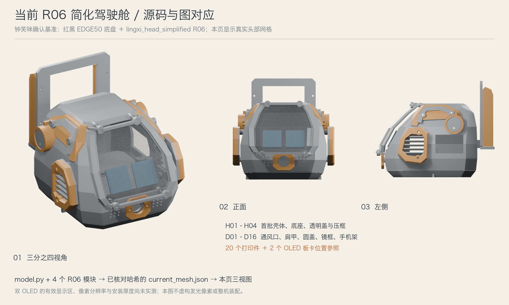
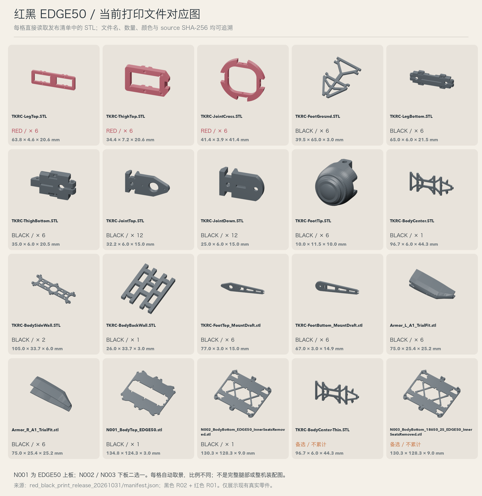
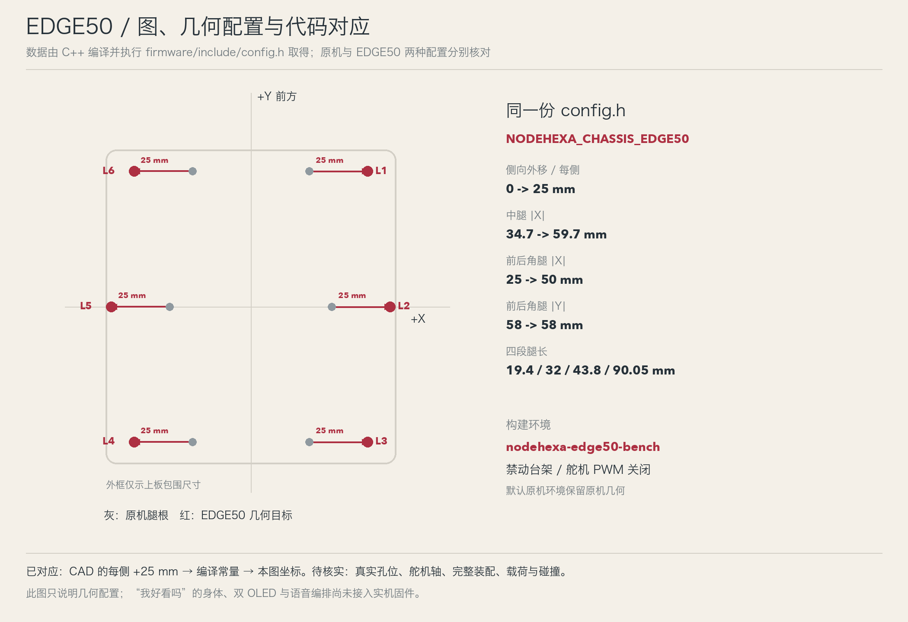

# R02：最新外形、代码与构建图对应

2026-10-31。钟笑咪已确认唯一基准：**红黑 EDGE50 底盘＋R06 简化驾驶舱（`lingxi_head_simplified`）**。状态：**同源构建图预览，等待视觉审阅；完整整机动作动画仍未对齐完成**。

本轮修正上一版引用旧驾驶舱、原宽底盘和单屏假设的问题。所有新图读取当前已存在的 CAD 网格或发布 STL，不重新雕刻外形，不修改 CAD 源码、CAD 评审页面或制造输出。图片中的头部为 20 个实际打印件，另显示两个 OLED 板卡位置参照；底盘图展示真实发布零件。

## 先看对应图

### R06 头部：当前源码对应的真实外形



### 红黑 EDGE50：发布文件与零件图一一对应



### 几何配置：CAD 加宽量对应实际 C++ 编译读数



## 对应依据

| 对象 | 当前依据 | 生成图 | 已核对的内容 |
| --- | --- | --- | --- |
| R06 头部 | `design/lingxi_head_simplified/source/model.py`、4 个 `decoration_*_R06.py` 模块、冻结的 R05A 主体和透明盖来源 | `current_head_views.png` | 缓存网格的源码、模块、参数、规格、清单哈希与当前文件一致；20 个打印件按原位显示 |
| 头部显示方案 | 当前规格中的 `REF_OLED_L` / `REF_OLED_R` | 头部图中的两块蓝色参照 | 两个模块位置参照；有效显示区、分辨率、含引脚厚度和最终固定孔仍待实测 |
| 红黑底盘 | `red_black_print_release_20261031/manifest.json`：黑色 R02＋红色 R01 | `current_parts_atlas.png` | 18 种主清单文件＋2 种备选文件逐一核对 SHA-256，保留原 STL 几何 |
| EDGE50 上下板 | 发布清单记录的 `nocturne_hexapod/source/edge_frames.py` 及下板 BRep 来源 | 图中 N001、N002、N003 | 当前源文件/BRep 与发布记录哈希一致；每侧加宽 25 mm，二选一下板分别显示 |
| 固件几何 | `firmware/include/config.h` | `code_geometry_map.png` | 主机 C++ 分别编译原机和 EDGE50，读取实际常量再比较 CAD 的每侧 25 mm 位移要求 |
| 构建环境 | `firmware/platformio.ini` 中 `nodehexa-edge50-bench` | 代码对应图及构建记录 | 继承 V2 禁动台架；保留 `NODEHEXA_BENCH_MODE`，新增 `NODEHEXA_CHASSIS_EDGE50` |

源文件及图片哈希分别保存在 [sources.lock.json](sources.lock.json)、[render_manifest.json](render_manifest.json)、[figures_manifest.json](figures_manifest.json)。如果源码、参数、模块或发布 STL 与记录不符，收集器或渲染器会拒绝继续，不能静默使用过期模型。

头部旧的 `outputs/renders/R06/R06_hero.png` 渲染记录中的源码哈希与当前源码不同，本轮没有将其当作当前图复用；新图直接读取已验证来源的 `review/cache/current_mesh.json` 重新渲染。

## 本轮代码改动

`config.h` 新增 `kChassisSideTranslationMm`：默认 0；启用 `NODEHEXA_CHASSIS_EDGE50` 时为 25。中腿安装坐标由 ±34.7 mm 变为 ±59.7 mm，角腿 X 由 ±25 mm 变为 ±50 mm；角腿 Y 保持 ±58 mm，四段有效腿长保持 19.4 / 32 / 43.8 / 90.05 mm。四足型号同时启用该标记会报编译错误，防止混用。

此改动只表达设计要求的腿根整体外移，不等于已经量测了打印孔中心与实物舵机轴。几何配置图中的外框为上板包围尺寸示意，不是完整总装。EDGE50 未同时启用 `NODEHEXA_BENCH_MODE` 时会被编译门禁拒绝；实体运动验证前不能直接以该标记生成运动固件。

新增 `nodehexa-edge50-bench` 环境，舵机 PWM 继续关闭。默认构建环境及其原机几何保持原样。该环境单独固定 `espressif32@6.9.0` / Arduino 2.0.17，适配当前旧版 LEDC 与 WebServer 代码；依据见 [PlatformIO 官方版本说明](https://github.com/platformio/platform-espressif32/releases/tag/v6.9.0)。未进行烧录或硬件运动。

第一次使用原来未固定版本的平台构建时，解析到了 espressif32 8.0.0 / Arduino 3.3.12，编译在既有 `buzzer.cpp` 的 `ledcSetup` / `ledcAttachPin` 处失败。修复范围限定在新台架环境的工具链选择，没有进行全项目 Arduino API 迁移。

## 验证状态

- 源码、缓存网格、发布 STL 与对应记录的哈希核对通过。
- 原机和 EDGE50 的 `config.h` 主机 C++ 编译及执行通过；两项横向坐标增量与 CAD 25 mm 要求一致，纵向坐标和四段腿长相同。
- 20 个头部打印件、两个 OLED 参照、20 种底盘清单/备选文件已按当前来源渲染；图中比例为各视图取景，不是统一物理比例。
- **完整 ESP32 固件构建尚未通过验证**：首次构建因 Arduino 3.x 的旧 LEDC API 不兼容而失败；专用环境固定为兼容框架后，依赖下载仍未完成。本轮按视觉预览门禁停止该准备过程，未宣称重编译成功。几何常量的主机 C++ 编译与执行已经通过。完整记录见 [build_checks.json](build_checks.json)。
- 最终源码—图像一致性结果见 [delivery_checks.json](delivery_checks.json)，可运行 `source/verify_delivery.py` 重新核对。
- CAD 原有评审网格的 nonmanifold-edge 警告仍保留；本轮只消费现有输出，没有进行 CAD 修复，也没有把图像渲染成功当作制造检查通过。

## 尚未对应完成的部分

最新模型尚没有经过验证的完整六足装配变换、舵机轴与各腿部外壳对应关系。不能把真实零件随意摆成一台“已装配”的机器人，也不能用旧的简化直杆动画证明新外壳可运动。头部/底盘/腿部的碰撞、实际重心与带载运动仍未验证。

“我好看吗”的完整身体、双 OLED、台词 cue 尚未接入机器人运行固件；本轮仅补了有对应图的几何配置与构建目标。旧 R01 的 12 秒视频只保留为节奏草稿，**不再作为当前外形或实机代码的预演入口**。

完整动作动画的下一阶段必须先补齐实际装配与关节轴依据，并确认双 OLED 的硬件显示参数，然后让动画和动作表读取同一份装配/几何配置。按协作规则，本轮展示图后暂停后续实现及测试修复，等待钟笑咪确认这套图与实际构建是否对应。

## 复现

从 `nodehexa-ai/` 执行。渲染只生成本目录中的衍生图和 Blender 文件，不更新 CAD 工程：

```bash
rtk proxy python3 design/robot_theater/aligned_r02/source/collect_sources.py
rtk proxy blender -b --factory-startup --python design/robot_theater/aligned_r02/source/render_current.py
rtk proxy python3 design/robot_theater/aligned_r02/source/compose_current.py
rtk proxy venv/bin/python -m platformio run -d firmware -e nodehexa-edge50-bench
```

上面的固件命令只编译，不包含 upload。对应图和构建状态的入口均在本目录；R01 历史文件保留在上一级。
